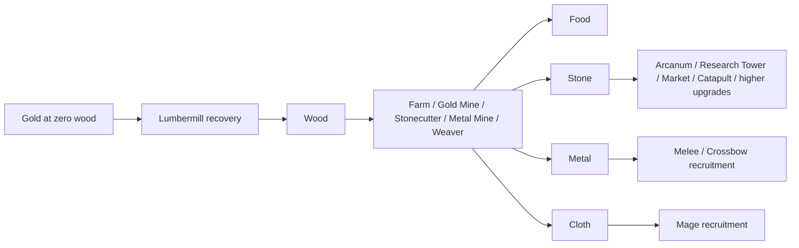
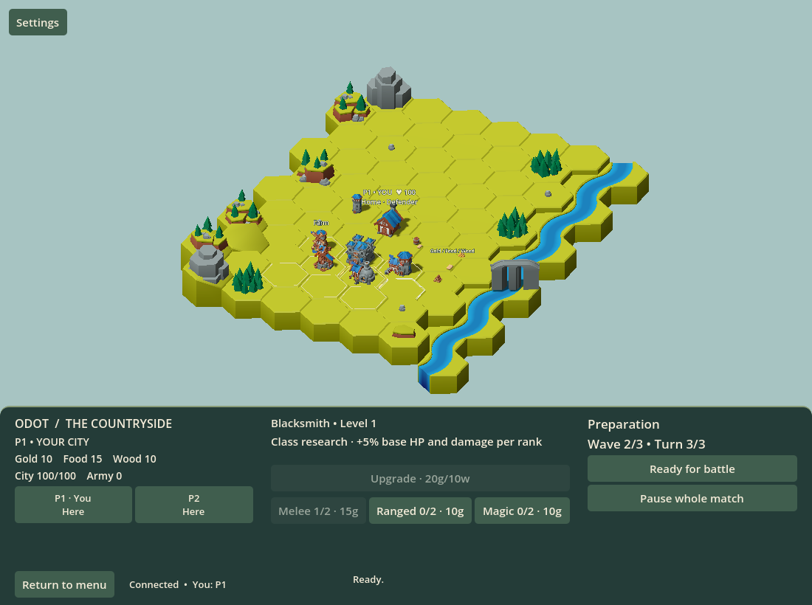
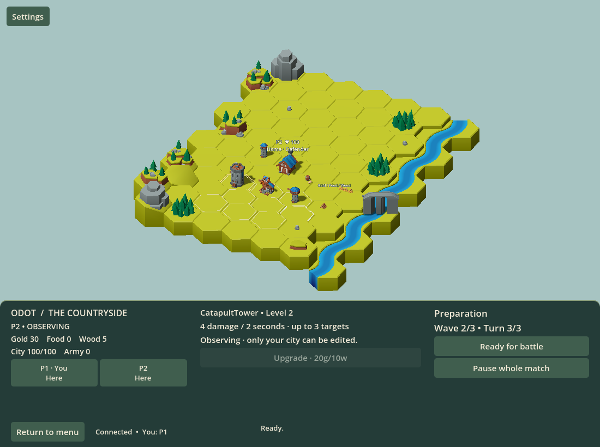
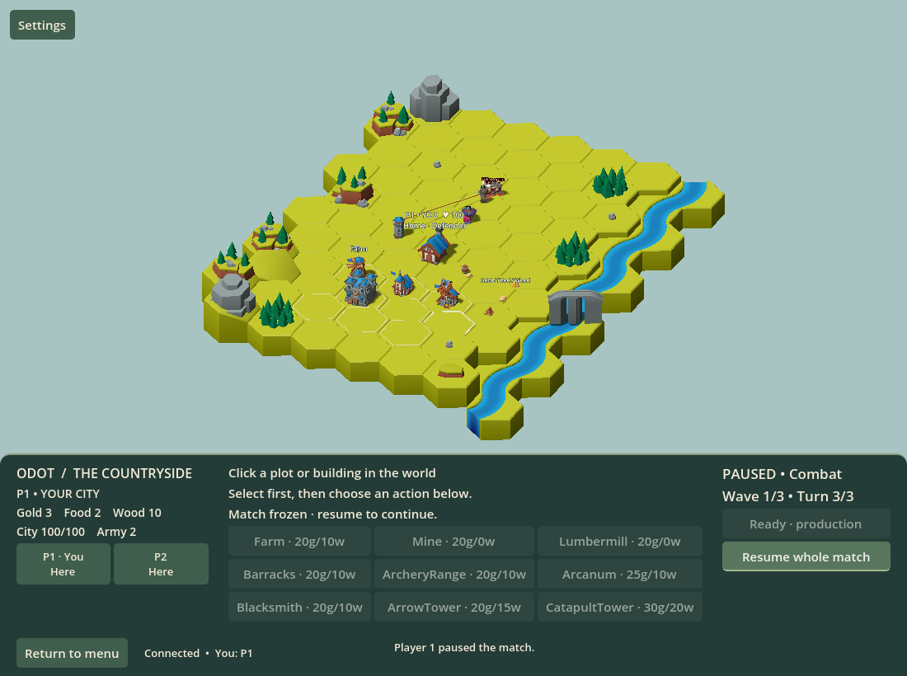
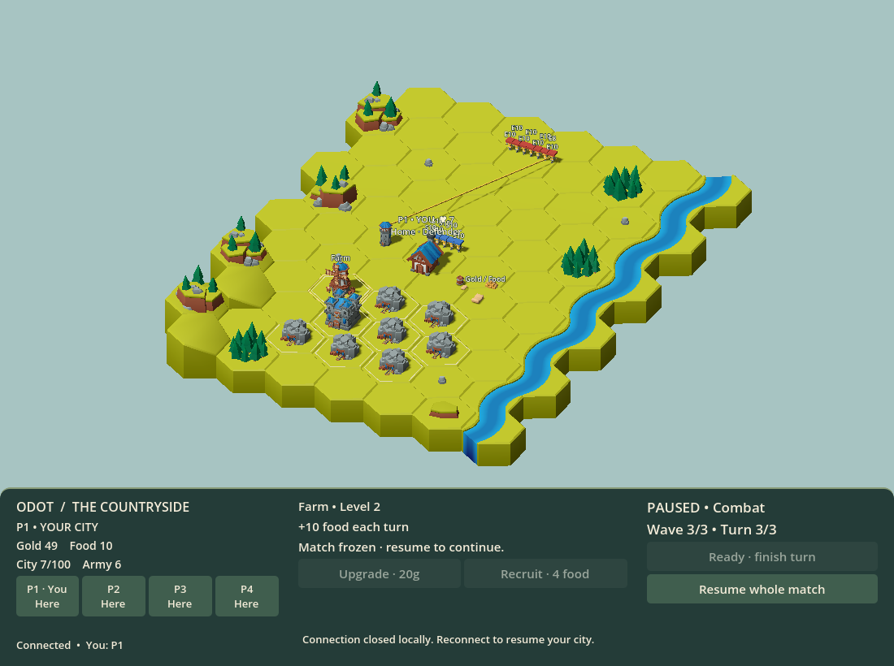

# The Common Watch: gameplay

See the [product introduction](../README.md) for the cooperative settlement-defense premise and [stable technical identity](../README.md#stable-technical-identity) for rebrand compatibility.

One to four players share a match, each owning five initially open plots among nine indexed building slots displayed as three horizontal staggered rows of pointy-top hex plots. The focused building district sits left of a river divider and the actual shared grassy arena, with enemy entries above the owned army homes. Graphical solo waits for Start so its doctrine can be chosen; headless automated solo starts Warden immediately. Hosted multiplayer waits for the original host to click Start. Join the roster before start. The roster is fixed after start; returning players can resume, fresh players cannot join. Return to menu and start again for a fresh local/hosted match; restart a dedicated server for another match.

The base allocation is 100 Keep health, 12 gold, 6 wood and zero food, stone, metal and cloth, adjusted once by its selected doctrine. The default Warden therefore starts with 10 gold, 6 wood and 2 stone. See [all six doctrines, 36 reward cards and nineteen drafts](roguelite.md) for exact effects and authoritative selection. Every living city, including an absent player's city, receives 2 base gold plus its producers' outputs at each of the three production events per wave (settled across three numbered preparations, as below). Producers consume no inputs. All costs and outputs use bounded whole-resource amounts; payment and production overflow reject the complete operation without partial spending or income.

These are the current unresearched defaults, exercised by the finite twenty-wave strategy sample below. [Worldtree production offshoots](worldtree.md#bounded-node-design) increase the affected producers' outputs. Rule tables and strategy descriptions use canonical identities; see [presentation names and substitutes](assets.md#names-versus-authoritative-identities) for the labels shown in the client. `G/W/S/M` mean gold/wood/stone/metal; omitted components are zero.

| Building | Construction | Maximum level | Level 1 / 2 output or role |
| --- | --- | ---: | --- |
| Lumbermill | 1 W | 2 | 1 / 2 wood |
| Farm | 2 W | 2 | 5 / 8 food |
| Gold Mine (existing Mine identity) | 2 W | 2 | 1 / 2 gold |
| Stonecutter | 2 W | 2 | 1 / 2 stone |
| Metal Mine | 2 W | 2 | 4 / 8 metal |
| Weaver | 2 W | 2 | 4 / 8 cloth |
| Barracks | 2 W | 5 | Swordsman and Berserker |
| Archery Range | 2 W | 5 | Crossbowman |
| Arcanum | 5 G + 2 W + 3 S | 5 | Mage |
| Research Tower | 2 W + 2 S | 2 | +1 / +2 research per three-production cycle |
| Arrow Tower | [Tower costs and paths](#defense-towers-on-army-plots) | 2 | [Tower profiles](#defense-towers-on-army-plots) |
| Catapult Tower | [Tower costs and paths](#defense-towers-on-army-plots) | 2 | [Within-squad X/Y profile](#defense-towers-on-army-plots) |
| Market | 2 W + 2 S | 1 | Explicit fixed-bundle sales |
| Town hall | 5 G + 2 W + 2 S | Independent tracks | [Storage and paid recovery](#purchased-army-homes-and-town-hall-rotation) |

Producer upgrades cost 2 W + 2 S. Research Tower upgrades cost 4 G + 2 W + 2 S; defense upgrades use the [tower paths and quotes](#defense-towers-on-army-plots). Barracks and Archery Range first upgrades cost 2 W; Arcanum's first upgrade costs 4 G + 2 W. Later recruitment upgrades cost respectively 6 G + 2 W + 2 S, 9 G + 2 W + 3 S and 14 G + 2 W + 4 S. Market has no upgrade. Quotes and output come from the authority's frozen catalog; custom Rules values are already in these units.

Basic producers, Barracks and Archery Range spend wood. Stock is the prerequisite even after its producer is sold. Arcanum needs stone to construct; Mages need cloth to recruit. Normal Lumbermills cost 1 wood. At exactly zero wood, an eligible owner can explicitly buy a recovery Lumbermill for 4 gold on an empty purchased plot. Normal requests never substitute currency. Recovery pays and records that actual quote, so its sale refunds 2 gold; an unupgraded normal Lumbermill refunds zero. Stone enables upgrades and advanced branches; metal and cloth fund ongoing equipment, while food pays battle upkeep.

The nine plot IDs stay stable. IDs 0–4 start purchased and IDs 5–8 remain selectable while locked. Purchase any locked plot for 5, 8, 12 then 18 gold, according to the number of expansions already purchased. These prices are balance candidates. Purchase requires no Market and remains permanent after selling its building. A stale expansion price is rejected; a full five-building city can buy more land without removing a building first.

Building sales also require no Market. The refund is half the actual paid construction and upgrade investment, rounded down independently after summing each resource. For example, 5 wood + 2 stone invested returns 2 wood + 1 stone. Plot purchases, recruitment and research spending are excluded. Sale removes production, recruitment access, research production or tower behavior, but retains existing soldiers, wounds, points, progress and technologies. Rebuilding creates a new level-one instance with fresh investment, gives no free soldier, and does not revive an old tower action. Requests aimed at the sold instance are rejected even if the same building type replaces it.

A currently owned Market enables explicit one-way sales at these base rates
(before [personal run effects](roguelite.md)): five wood or stone returns one gold; five metal or cloth returns two gold; 25 food returns one gold. Sell a positive whole bundle count. No imports, automatic sales or rate stacking from additional Markets exist. Selling the last Market removes stock-trade access immediately. The food-sale preview shows the resulting payment and exact sit-out count before acceptance. Selling food reduces the food available for the forthcoming upkeep calculation at the battle boundary. Stock deduction and proceeds are atomic, including overflow rejection.

## Preparation and battle controls

Click an outlined plot or a building roof to select its stable slot, then choose an action in the bottom panel. Clicking only selects. Recruitment appears only at the matching building. Open Worldtree without selecting a plot to inspect or buy technologies; viewing another city shows a read-only tree. City tabs clear selection and permit inspection of other players' cities. Ready prevents editing; Unready restores it until all connected living players are ready. Each wave's preparation/battle cycle is **Preparation 1, Preparation 2, Preparation 3, Combat**; the [earned reward draft](roguelite.md#earn-and-choose-rewards) sits between successful nonfinal battles and the next cycle. The old income-free fourth preparation is consolidated into preparation 3. Each preparation's Ready settles one production using the then-current buildings, research and eligible stored army. Resource balances, research progress and recovery are preflighted before any mutation. Preparations 1/2 clear readiness into the next preparation. Final preparation permits all existing construction, upgrades, research, recruitment and assignment operations using two settled productions. **Ready for battle** settles production 3, pays upkeep once from the resulting food and immediately starts combat. Final-phase buildings and research/healing upgrades affect that settlement; there is no intervening spending or fourth ready stage. Twenty waves still have sixty production events, but only sixty numbered preparation checks total. The phase and stage serial guard reject delayed commands, including old ready commands. Ready/unready, pause/resume and reconnect cannot replay the entry settlement. If prior-wave cosmetic bodies remain, final readiness waits for their cleanup before settling production and paying upkeep; no repeated Ready is needed if connected/living eligibility still holds.

The **Combat speed** control at the top selects one global pace, default **1x**:

| Selection | Former combat pace | Simulated ticks per wall second |
| --- | ---: | ---: |
| 1x | 0.5 | 30 |
| 1.5x | 0.75 | 45 |
| 2x | 1.0 | 60 |

The original playing host controls it; guests cannot change it. Solo uses its owner, while any authenticated connected member can select the pace on a dedicated server. The accepted selection is synchronized and can change during preparation, combat or shared pause, independently of readiness or elimination. Disconnected and terminal views cannot change it. Unit timing, damage, movement and status durations remain unchanged in simulated ticks; the control changes wall-time pace, not balance. Reconnect to the same running authority retains the selection.

Throughout preparation, the shared arena displays the actual **next-wave enemies** as idle gold-marked formations with text-free member lifebars, including inherited fallen-city pressure. Owned and co-op field members use their actual forthcoming homes, persistent formation slots and current food forecast; stored, unfunded and queued members have no field body. Preview and combat start share member geometry and facing, including the physical Keep and Watchpost, without advancing simulation. The Watchpost displays its forthcoming reset. See [horizontal-board projection and verification](horizontal-board.md) for the parity boundary and headless limitations. Click a figure to open the ordinary unit inspector with its real type, level, health, damage and boss profile. Forecast figures are read-only: no owned army actions, live targets or combat occupancy. Combat entry replaces them with the allocated live attackers and clears stale forecast inspection.

The top-right text table shows **Resource**, **Stock** and **Income/production**, in Gold/Food/Wood/Stone/Metal/Cloth order. Income is synchronized base gold plus current researched and run-modified production; it changes after construction, upgrade, sale, production research or an applicable reward without paying production. Positive income uses `+`, zero uses `0`; custom overflow is `Unavailable`. All three preparations explain that Ready settles one production. In Combat the heading is **Next production**; the last production was already settled before upkeep. Fallen and terminal cities have zero future income. Paused/stale labels retain synchronized values; reconnect and city switching refresh from the authority.

The small **Upkeep** table directly underneath shows **Next battle** food demand and **Food after payment**. On shortage it shows the exact number of soldiers that **will sit out** for a field-only army, or **Unfunded soldiers** when Town hall storage is present: stored units never fight, even when funded. In final preparation the forecast includes the imminent production before funding soldiers; stock remains unchanged until readiness resolves. Six Swordsmen with forecast availability 15 show demand 6 and balance 9. Missing income or resource overflow shows an unavailable forecast rather than invented funding. A shortage alone does not disable Ready. Details retains the projected payment and the [field-first food allocation](#deterministic-hex-combat). Combat shows **Paid this battle · WN** and the actual payment/reserve count; outcomes show **Last battle · WN**. Fresh sessions clear old receipts. Both tables block world click, zoom and drag initiation. Producer controls show complete cost and output per turn; upgrades show current → next output, and disabled quotes explain **Need N more resource** with its producer source.

Enemy pressure uses an authored twenty-wave catalog per original player, expanding entries with the stated level and rank zero. A seed-isolated bounded permutation changes entry order, not composition, count, level, bosses or numerical budget. The authoritative forecast and actual combat allocation consume the same planned order. See [every configured wave](wave-power.md#every-configured-wave) for the compositions and [the enemy-strength rule](wave-power.md#baseline-and-rule) for profile scaling and the distinction between balance score and experiential difficulty.

The built-in defender is the physical Watchpost weapon, with a two-damage shot every second outside the nine settlement plots. Unit and tower impacts share one simultaneous damage accumulator. Survivors retain identity, level and remaining health between waves; cities retain damage too. A normal shared clear awards each surviving city two gold, five food and one wood; boss clears double those values. Disconnected survivors receive rewards, fallen cities do not. Local clear gives nothing while other living or queued enemies remain. The final doubled reward is included in victory, without another production, upkeep payment or twenty-first wave. Total gross rewards are 44 gold, 110 food and 22 wood for a city surviving every default clear; net balances also include spending, upkeep and production. These ordinary clear rewards never supply stone, metal or cloth; separately selected reward cards can supply resources and Iron Harvest adds its earned Metal to the clear receipt. Successful waves 1–19 then enter the three-card draft, without an economy settlement; wave 20 goes directly to victory.

Before battle, the authority also checks that the eventual reward, including possible Iron Harvest and the next Ancient Codex point, can fit bounded stocks after upkeep. Overflow rejects readiness without payment or phase change; spend stocks before retrying. Rewards use one guarded shared transition after defeat precedence, so retries, reconnect and corpse cleanup cannot pay twice.

A Keep falls at zero health. Its owner stops development/weapons/future participation
but current funded fighters continue to the shared result. Enemy groups redirect
preferred sectors in stable balanced allocation, preserving current poses,
identities, statuses and committed timing without teleportation. Simultaneously
fallen owners cannot receive preferences. Future waves retain one authored
allocation per original player, split among living owners including disconnected
ones. Eliminated rosters remain inspectable without future upkeep/healing/revival.
All players share W20 victory if a Keep survives; all Keeps falling takes defeat
precedence even with simultaneous final enemy deaths.

The ordinary first defense starts Farm, Metal Mine and Barracks. Two productions supply eight spendable metal and ten food for four Swordsmen before final readiness; the third production supplies another four metal and five food immediately before four-food upkeep. Two purchased homes still have six-Swordsman capacity. Previously the income-free fourth editing opportunity allowed six recruits and left nine food after upkeep; the adopted flow instead leaves eleven food and four metal at combat entry. A Stonecutter/Metal Mine/Lumbermill opening must construct its Catapult before the third settlement if affordable, or during the next wave's preparation, not after final readiness. The historical four-phase flow's finite campaign qualification is recorded below; it is not a qualification of the consolidated three-phase editing windows. No compensating income or fourth edit is added. The funded support opening instead buys Farm, two Metal Mines and a zero-wood gold recovery Lumbermill before END1; after two settlements, selling the temporary mine funds the Barracks and sixteen metal pays for six Swordsmen before END3. This ordinary-command opening underlies the current finite cooperative and solo policy controls.

Any connected roster member can pause or resume the whole match. Pause freezes movement, attack cooldowns, health, production and turn progression. It also rejects economy/readiness commands. Networking stays active, and absent players can reconnect. Disconnecting itself never pauses or deletes a city: production/combat continue, readiness clears, and disconnected players do not block the ready check. With no connected living players, building waits; combat keeps running unless paused.

Walls, general repeatable field/city healing, save recovery, host migration, server restart recovery and matchmaking remain outside this change. The one-time Field Surgeons card is a bounded healing exception. Town hall recovery is the bounded stored-unit exception described below. Land expansion, building sales and explicit Market trades use the same authoritative economy command path. Battle upkeep is charged once when preparation actually becomes combat, after prior cosmetic cleanup completes. Rules and typed catalogs are centralized in `src/Game.Core`; the server sends costs/output values in snapshots so the UI uses the actual rules.

The bottom panel keeps city resources/health/army and inspection tabs on the left, selected building details/costs in the middle, and match controls on the right. Start is available to the original playing host in a hosted lobby (or connected players on a dedicated server); Ready/Unready and Pause/Resume follow the authoritative phase. Connection and rejection messages appear along the bottom. A disconnected window offers Reconnect to my city; a synchronized resume retains the city and starts with no selected plot. Expired credentials expose the fresh-session lobby action. Fallen players can inspect all cities and pause/resume; victory/defeat remains visible to the entire roster.

## Music and local settings

Press **Esc** or click **Settings** in the top-left to open Graphics and Audio.
Press Esc again or **Close** to return; Esc dismisses an open dropdown first.
Opening settings blocks gameplay input in your window while the shared match and
network updates continue. Use **Pause whole match** separately to pause everyone.
One application music player continues across menu, solo/hosted sessions, connecting, pauses/outcomes and reconnects.

Graphics offers **Windowed** and **Fullscreen**. Windowed resolution changes the
window's size, with 1100×820, 1280×720, 1600×900, and 1920×1080 offered when they
fit your monitor's usable area. Fullscreen uses the current monitor's native size;
the windowed selector is disabled until you return to Windowed, restoring your
previous size. Manual resizing is shown as a custom size. Saved sizes that no
longer fit fall back to a usable size. Explicit engine launch arguments such as
`--resolution`, `--fullscreen`, and `--windowed` take precedence for that launch;
those overrides do not become saved preferences until you edit display settings.

Audio provides a live **Master volume** slider from **0–100**. Zero mutes all
audio; raising it restores music at its ongoing position. First-launch defaults
are Windowed 1100×820 and Master 50, with the music itself mixed at -12 dB.
The bundled Echoes of Valhalla track plays its intro once and repeats its authored
loop through Godot's WAV playback.

Preferences are stored separately from multiplayer credentials in
`user://settings.cfg` (on a standard Linux desktop,
`~/.local/share/godot/app_userdata/Odot - Nine Tiles/settings.cfg`). Display
selections, completed slider edits, menu closing, and pending changes on orderly
exit save them. Restart restores valid values; reconnect retains the current
ones. Invalid/missing fields use defaults. A failed save displays a message in
the menu while your current settings keep working.

Two running local clients keep independent live preferences. The last successful
save becomes the shared OS user's defaults for later launches; it never updates
the other running window. Servers and headless clients ignore graphical settings
and do not create music players. Music provenance and import details are recorded
in [the asset README](../src/Game/Assets/Music/README.md).

## Start screen and session lifetime

A normal graphical launch opens **Single player**, **Multiplayer**, **Settings**
and **Exit Game**, over the shared starting-village scenery described in the [product guide](../README.md#development-commands). Keyboard arrows/Tab and
Enter work alongside pointer input. The menu creates no match or gameplay socket.
The bottom of the start screen and Multiplayer view shows your Steam display
name, or **Open Steam to log in** when Steam is unavailable or offline. Host game
checks the current login each time and warns you to open Steam and log in before
creating a lobby.

Single player binds one local city and uses the same validated actions and rules
as multiplayer. Multiplayer offers **Host game** and **Back**. With Steam running
and signed in, Host game creates a private invitation-only lobby; use **Invite
friends** in the bottom panel. Steam’s overlay must be enabled; Shift+Tab
checks whether it can open. If it is unavailable or an invitation dialog does
not activate, the bottom panel explains the problem. Only the original host
starts the match. Missing
Steam/login/access reports recoverable feedback; solo, settings, Back and Exit
remain available. The local `mise run dev` host/guest flow uses ENet independently.

**Return to menu** ends unsaved solo/host gameplay and clears selection and
pending actions; preferences and music persist. Guests keep private credentials
for the same running host. An invitation during a match asks before leaving;
declining preserves it. Returning players can resume after the roster locks,
including pause or elimination, using their retained credential and Steam account.
Fresh players cannot join after start. A new host session has a new match and
refuses old credentials.

The original host owns the whole hosted session. Its orderly leave ends the
session for guests; unexpected loss disables guest actions and offers bounded
reconnect/return feedback. A Steam lobby owner change never migrates gameplay.
**Exit Game** and the window's native close control stop the session, music,
network/Steam resources and the game process. Closing settings restores valid
focus and changes neither readiness nor shared pause.

## Deterministic hex combat

Each authoritative `Match` owns one private Arch member store. Individual IDs,
HP, equipment, experience, status and formation slots persist; a homogeneous
`CombatSquad` owns the only movement/target/action cycle. All authorities use
60Hz rules, and animation never applies damage. See [shared arena](shared-arena.md)
for the numerical and compatibility owners.

One connected arena has seven columns by nine rows per original owner, for
63–252 cells. Each participating squad claims one exclusive hex regardless of
population; default capacity is three same-type soldiers. Bosses use one member
and the same exclusive actor architecture. Six preparation homes, physical Keep,
forward Watchpost and reserved purchased-weapon cells are separate from nine
settlement plots. Ownership constrains preparation placement, never battle movement.
Stored/unfunded/queued members have no active claims or world bodies. Enemy entries
form homogeneous groups in canonical order; overflow retains identities until entry.

| Archetype | HP | X / Y | Structure | Equipment | Food | Initiative | Range | Move | Windup / recovery |
| --- | ---: | ---: | ---: | --- | ---: | ---: | ---: | ---: | ---: |
| Swordsman | 40 | 10 / 0 | 5 | 2 metal | 1 | 10 | 1 | 30 | 12 / 48 |
| Berserker | 30 | 15 / 3 | 7 | 3 metal | 2 | 20 | 1 | 27 | 18 / 54 |
| Crossbowman | 40 | 12 / 0 | 3 | 1 metal + 2 wood | 1 | 30 | 3 | 30 | 18 / 42 |
| Mage | 25 | 12 / 4 | 4 | 3 cloth + 1 gold | 2 | 40 | 3 | 30 | 24 / 66 |

These are player level-one bases; all death intervals are48ticks. Enemy profiles
follow [the wave-power rule](wave-power.md#baseline-and-rule) after level/boss/rank scaling. Six Crossbowmen in two
full squads survive the default W1 encounter at seeds1/123 with normal player
profiles. That equipment/food fixture is arithmetic, not an earned opening.
Earlier pure-ranged paid losses remain in the [historical baselines](paid-squad-baselines.md);
[current finite paired paid evidence](wave-power.md#headless-encounter-evidence)
shows easier openings without certifying every ranged strategy.

New recruits capture trainer level1..5. Veterans retain their own levels/wounds.
HP and X/Y/structure scale from original bases by1.35 per level, rounding nearest
whole point with midpoint ties upward, then boss/research stages. Swordsman HP
is40/54/73/98/133 and X10/14/18/25/33. Default bosses are L3/L5 Swordsmen with
8x leveled HP and2x direct damage, without phases/escorts, before enemy scaling;
see [resolved boss stats and rounding](wave-power.md#rounding-minimums-bosses-and-receipts).
Equipment components
scale by1.35 with positive midpoint-up rounding; zeros remain zero. Recruitment
never spends food or heals veterans. Surviving funded field participants gain
one service point per successful clear, including current-wave fallen-owner
fighters; service never automatically upgrades equipment.

Battle entry pays upkeep once for all living owned members of living cities,
including storage and disconnected owners. Field comes first, then storage;
each group sorts by descending equipment level and stable ID. Unaffordable
members are skipped and cheaper members considered, without debt or blocking
readiness. Only funded field members fight; paying a stored member never deploys
it. Forecasts include the final imminent production, complete food-sale quotes
and actual funded/participant/reserve IDs. Final END cannot create another edit
window. Retries, reconnect, pause and cleanup do not repay upkeep. Funded prior
battle members may recover only through actual eligible Hall production.

Ready actors engage in-range opponent groups before routing. Enemy structural
preferences rank own Watchpost/Keep before foreign objectives, while range,
reachable approach length and seeded ties govern current eligible decisions.
No sector excludes foreign opponents. One shared reachability search scores
legal approaches; nearer current opportunities precede retained farther routes.
Committed moves/windup/recovery finish unchanged before reevaluation. Stable
blocked inputs preserve decision identity, wait and never reroll from rendering.

Contested destinations use lower actor initiative then seeded ties. Friendly
chains/swaps/cycles commit together at one common arrival deadline; unrelated
moves keep their own timing. Opposing exchanges refuse atomically. A squad
moving fromA at100 toB at130 is attackable only atA before130 and onlyB at130.
No attack interrupts a committed step or creates partial source/transit claims.

Every living participant contributes X to one seeded primary and Y to every
other pre-impact living participant in the locked target group. There is no
victim cap or cross-hex splash, overkill redistribution or neighboring-group hit.
Structures use separate damage, not a member pool. Losing a whole target group
or physical range causes one miss with unchanged recovery. All valid same-tick
unit/weapon/periodic contributions resolve before casualties. Fire/Venom/Frost
follow actual positive-damage victims; healthy members contribute zero to the
rounded-up mean squad chill sampled only when a new action commits.

Watchposts reset to their resolved maximum per living owner each wave (50 base
HP, modified by [personal run effects](roguelite.md)) and physically originate the
existing2damage/second/range4 defender. Destruction stops it and applies one
20% direct-damage reduction to owning participating squads for240ticks; it does
not stop movement/attacks. Keeps retain100HP wounds across waves and are
vulnerable in physical range while distant defenders live. Purchased weapons
have independent physical origins/ranges and stop after Keep fall without
invented tower destruction. Arrows are X-only; Catapult/Bombard use within-group
X/Y. Tower locations matter geometrically.

Member death immediately removes its contribution. The last participant's death
releases the squad's logical source/transit claims on that tick. Cosmetic bodies
retain frozen physical movement/facing while imported death clips advance to
expiry, without collision or targets. Death at200 expires at248. Wave outcome
does not wait for bodies, but next formation waits for bounded cosmetic cleanup.
Pause/loss freezes playback; reconnect samples current elapsed bodies/actions
without historical hits/shots/sounds. Session replacement releases all old state.

The non-secret seed and complete rules fingerprint cover actual shared geometry,
profiles/status/economy/campaign/flow inputs. Protocol16/rules7/flow3 refuses
legacy city-local size-budget/capped-splash projections. Seeded canonical inputs
and ordered commands reproduce normalized claims/actions/victims regardless of
storage traversal, session GUID or frame rate. Scenery never consumes combat RNG.
No-health-progress3600ticks and wave18000ticks remain bounded; only actual
member/structure health loss counts. All-Keeps-fallen defeat precedes simultaneous
clear, and ordinary results precede BattleStalled. Stalled defeat retains health
and is never accepted as a normal clear.

The [authored animation and equipment contract](assets.md#authored-animation-and-equipment-contract) owns rig, socket, clip and attack-marker details. Committed visual steps interpolate straight between their declared anchors on the common snapshot clock, using walking instead of sprinting. Transient visual crossings of other moving, standing or dying models are intentional; settled members use distinct cosmetic formation slots around their squad's shared anchor. None of these crossings changes numerical capacity, source attackability, reservations, route choice or arrival timing. Programmatic AnimationTrees sample bounded idle/walk, attack and filtered hit blends, with immediate terminal death precedence. Facing follows the shortest angle using combat-clock advancement and freezes with positions/poses on pause or transport loss. Admission reconstructs the current direction rather than playing a historical turn. These blends add no separate slow motion: all concurrent action deadlines and outcomes remain unchanged in simulated ticks, while wall-time playback follows the accepted [global combat speed](#preparation-and-battle-controls). Horizontal root motion is suppressed; authored attack poses map onto authoritative impact and recovery. Cosmetic effects never apply damage. The hex presentation migration aligns death clips and retained bodies to authoritative death intervals, including cleanup outside combat and reconnect. See the [migration report](authored-migration.md#retained-acceptance-evidence) for source/package checks, input boundaries and coverage limitations.

[Available substitutes and grounding](assets.md#available-substitutes-and-grounding) describe the current scenery and upgrade palette. Raised surfaces, building bounds and selection rings use per-plot heights. The combat approach stays flat. Level two adds distinct structures/props instead of enlarging the whole building. Procedural flags use restrained motion on the same presentation clock; the Bakery has no windmill animation.

The [documented stockpile substitutes](assets.md#available-substitutes-and-grounding) represent stocks with bounded instance tiers: zero → 0, 1–19 → 1, 20–49 → 3, 50+ → 6 per resource. HUD amounts remain exact. Switching cities and reconnecting reconstruct current stocks without replaying earnings.

Accepted local construction/recruitment/research commands cue once by match and sequence; retries and rejections do not repeat success puffs. Battle sparks, projectiles and skeleton rattles use the buffered event cursor. Focus changes/reconnect/gaps discard historical effects. Effects cap at 64 and audio at eight voices, dropping cosmetic overload only. All cues route through Master; pause/loss stop voices, and session teardown removes them while the application music continues. Original sounds use 22,050 Hz mono signed 16-bit PCM, 0.12-second cubic decay, sine frequencies 110/220/330/440/660/880 Hz and fixed-seed noise transients. Village ambience is a restrained synthesized cue every 12 unpaused seconds. Silent Dummy-audio verification checks lifecycle/routing/mute state, not listening quality. Headless roles instantiate none of this presentation.

`CombatPlayback` owns one shared snapshot clock, bounded to at most three ticks
behind the latest accepted state and never extrapolating beyond authority. Its
accepted-frame buffer retains the sampled baseline and distinct later frames
until their admission, arrival, action-start and death boundaries mature, even
when several newer revisions arrive first. Same-tick corrections replace that
tick's frame; advancing the clock releases older frames. Models and squad
membership/pose/HP summaries use this same member projection. Rally summaries
sample the existing pending events at that clock, not the newest deadline.
Pause snaps to the accepted tick and freezes advancement; admission/resume,
event gaps and match replacement reset the buffer. `CombatPlaybackTests` and
the native `arena` component cover consecutive boundaries, expiry and resets.
A 120-tick, at-most-4096-record event history carries final casualty states. Initial admission, reconnect and detected
history gaps baseline the event cursor at the current high-water mark: current
living poses and unexpired dying bodies are reconstructed from complete state,
without historical effects. Overlapping snapshots deduplicate effects;
revision and match guards reject stale state. A fresh session clears all live/dead
views, pose buffers and cursors.

New entry visuals wait for their deployment snapshot’s common clock before appearing, preserving separation from interpolated neighbors. Surviving city-roster units retain their exact assignments and return to those homes only after all retained cosmetic bodies expire, including final victory. Stored units have no battlefield model or combat claim.

The [coverage replacement ledger](testing-audit.md#coherent-admission-profile-and-compatibility-replacement-2026-10-13) owns the squad-era numerical fixture inventory. Arithmetic combat fixtures are not earned economy or paid campaign evidence; [paid squad baselines](paid-squad-baselines.md) retain historical ordinary-command strategies and outcomes, while [wave power](wave-power.md#headless-encounter-evidence) owns current paired paid evidence.

The [historical four-phase campaign receipts](verification-history.md#simplified-building-economy-verification) own the finite strategy sample and paid policy transcripts; they do not qualify the current three-preparation spending windows.

A producer upgrade adds one level-one output while saving a plot and gold compared with purchasing another plot and producer, but requires stone. At current rates, two turns of a level-one Metal Mine produce eight metal: selling five returns two gold and retains three metal, versus two gold from a level-one Gold Mine over the same turns; this consumes equipment stock and requires an additional paid Market. Markets and Gold Mines therefore have different land and supply costs. The receipt/action logs record stocks before/after commands, investment, individual army levels/health, forecast/actual rations, casualties, rewards, city health and per-wave ticks.

[Current paired paid evidence](wave-power.md#headless-encounter-evidence) and [historical paid squad baselines](paid-squad-baselines.md) distinguish the rebalance from earlier earned progression; [shared-arena receiving and resume](shared-arena.md#eliminated-owner-receiving-and-resume) distinguishes it from controlled elimination and real transport. The former occupied-source admission experiment is retained only in the [historical reconstruction checkpoint](battle-flow-reconstruction-coverage.md#authorized-split-paid-progression-and-genuinely-occupied-production-admission). The historical pre-buff Mage/Crossbowman role witness used six ordinary screen units against six ordinary enemies at seed 123, identical identities and the shared live interval. Mage equipment is 3 cloth/1 gold and upkeep two; Crossbow equipment is one metal/two wood and upkeep one. Both clear normally; effective support damage is 6400 versus 4000 hundredths, clearance 253 versus 283 ticks, and surviving army HP 17500 versus 16000 hundredths. No inflated enemy HP, seeded clustering or altered default profiles are used.

## Purchased army homes and Town hall rotation

Each city has six numbered homes, two initially purchased. One purchased
tower-free home holds one homogeneous squad up to three members, including
unfunded reserves. Eighteen members need all six homes. Buy any numbered locked
army plot at5/8/12/18gold in purchase-count order; only that chosen plot unlocks,
independently of city land and Hall upgrades. First-fit recruitment/return skips
locked/full/tower homes and compatible partial squads retain their veterans.

Open **Squads** for per-owner member HP/equipment/service/status inspection,
**Recruit new squad**, selected **Paid reinforcement**, compatible member transfer,
**Store veteran**, **Return veteran** and **Retire · no refund**. Town Hall uses
individual slots. Accepted snapshots alone change rosters; delayed acknowledgments
and rejection create no optimistic member or spending. Native selection/focus
survives ordinary revisions. Foreign cities and ready/paused/disconnected/combat/
fallen owners remain read-only; full/foreign/stale destinations refuse atomically.

**Deployment** shows the connected arena. Select an owned squad, close the panel,
then click an available owned purchased home. Its complete home claim moves
atomically; it remains that squad's preparation home independent of battle pose.
Home rings distinguish selected/available/occupied/locked/tower states by color;
only empty homes have world text. Occupied squads and purchased towers are
identified through panels/inspection, not floating labels. Selection alone does
not spend, move or enable foreign editing.
Survivors return to those persistent homes after cosmetic cleanup without healing.
During post-clear cleanup, accepted deployment, recruitment, regrouping, Hall
storage/return, retirement and army-tower edits update persistent claims and
rosters immediately. Home eligibility uses current purchases, tower sales and
other squads' home claims, independently of retained battlefield footprints or
a survivor physically passing through that home. Unchanged survivors keep their
frozen source/transit/action until cleanup; new or reassigned members do not gain
colliding physical claims. Removing or reassigning the final participant releases
the squad's source/transit claims even if living reserves remain. Cleanup refreshes
footprints and restores the current home assignments before a waiting final END
settles production and starts battle. The compressed receiving cases in
`SnapshotReceivingLifecycleTests` cover these edits and the three-settlement gate.

### Defense towers on army plots

Every empty owned army plot can hold a defense tower using the existing paid construction mechanism. A squad-occupied plot cannot build a tower, even with unused member capacity. A tower excludes that complete home and its physical arena footprint, and no recruitment or Hall return can assign members there. Selling the tower removes its defense actor, retains purchased land and immediately frees the persistent home for eligible recruitment, Hall return or deployment; during post-clear corpse cleanup its old physical footprint remains until the cleanup barrier described above. Sale refunds the existing component-wise half of actual construction and upgrade investment, never land. Existing city-plot towers remain clickable and use the same actions. See [shared arena topology](shared-arena.md#numerical-ownership) for reserved weapon footprints and battle movement.

Click a base Arrow tower to inspect its damage/timing and choose exactly one paid upgrade:

| Tower | Construction / upgrade payment | Damage | Windup / total cadence (60 Hz ticks) | Damage footprint |
| --- | --- | --- | --- | --- |
| Base Arrow tower (L1) | Existing 4 gold + 3 wood construction | 5 HP | 12 / 60 | Single target, no splash |
| Rapid arrow tower (L2) | 4 gold + 2 wood + 2 stone upgrade | 7 HP | 6 / 30 | Single target, no splash |
| Bombard tower (L2 from base Arrow tower) | 4 gold + 2 wood + 2 stone + 1 metal upgrade | 8 HP | 30 / 120 | 8X to one primary and 6Y to every other living member of the selected squad |

The existing directly constructed `CatapultTower` (named Bombard tower in the UI) remains available at 6 gold + 4 wood + 3 stone + 2 metal. Its L1/L2 profiles retain 6/8X and 6Y at both levels, with 30/120 timing and every eligible secondary
member of its selected group hit once. The ordinary L2 upgrade uses the bombard
payment in the table. Legacy scripted ArrowTower L2 retains7X,12/60timing, X-only;
native RapidArrowTower/BombardTower have their own frozen profiles and identities.
Physical range/origin, landed group validity, simultaneous accumulation and
miss/recovery apply to all. No radius/victim cap or city-isolated damage rule remains.

Generation/level, price-count, ownership, phase, ready/pause and resource guards reject stale or conflicting intents before payment. Retry ledgers never charge again. Tower state, per-plot ownership/identity/investment and unit assignments survive the normal snapshot codec and credential resume. See [session compatibility](sessions.md) for command IDs, version admission, legacy actions, configuration/decision identities and the persistence boundary.

### Town hall storage and recovery

A Town hall occupies one purchased building plot. Its two independently quoted tracks are:

| Track | Level 1 / 2 / 3 | Upgrade to level 2 | Upgrade to level 3 |
| --- | --- | --- | --- |
| Storage | 6 / 12 / 18 individual soldiers | 8 G + 2 W + 2 S | 12 G + 2 W + 3 S |
| Healing | 5 / 10 / 15% current maximum HP per actual production | 6 G + 2 W + 2 S | 12 G + 2 W + 3 S |

Storage uses first-fit individual slots, independent of squad population or battlefield cells. Several halls each own their generation-specific inventory. Neither track purchases battlefield homes. Occupied-hall sale rejects; empty sale includes actual construction and both tracks' investments in the existing component-wise half refund. These tracks do not upgrade individual unit levels.

Recovery requires that the **same living ID's food was funded in the most recently completed shared battle**. Field-funded survivors can rotate into storage with that eligibility. First-cycle storage and newly recruited IDs have no completed paid receipt; merely storing them grants no healing. Unfunded stored units cannot recover until funded through a subsequent completed battle. At each real production, heal only currently stored eligible units by `ceil(current maximum integer HP × percent / 100)`, capped at maximum; integer HP uses hundredths. A 40-HP unit at 5% gains 2 HP per production, at most 6 HP over the three-production cycle. Changed research maximums affect the calculation, not eligibility and never retroactively heal wounds.

Health, resources and research preflight together before production commits. Editing during preparation, Ready/unready toggles before resolution, upgrades, transfers, selection, pause, reconnect, retries and elapsed wall time cannot create another heal; the three actual settlements follow [preparation timing](#preparation-and-battle-controls). Completed funding is separate from the current in-progress battle's payment receipt. Food-starved storage creates no damage, debt or automatic eviction.

The historical four-edit paid `ArmyBalanceTests` comparison covered seeds 0/1/123, frontline versus reserve rotation and the selected **5/8/12/18** versus **5/8/16/24** control. Both curves support those twelve finite main campaigns. Reserve investment meaningfully reduces replacements while delaying field expansion; it is not compulsory to win. Initial-home-only and no-tier controls still lose. See [verification evidence](verification-history.md#army-homes-and-town-hall-2026-10-03) for per-wave costs, casualties, recovery and limitations. No enemy, AoE, boss, food-rate or release-version rebalance accompanies these choices.

## Personal research and temporary statuses

Research resets each match and remains personal across its twenty waves and reconnects. Research starts at zero before the Arcanist's one-point starting allocation. Surviving cities, including disconnected owners, receive **one baseline point per shared clear**, including bosses and final victory. Forgotten Knowledge grants two immediate personal points; Ancient Codex adds one every second subsequent successful clear, excluding its acquisition clear. No local-clear payment or boss research multiplier exists. Receipts identify the actual awarded points and wave; retries do not pay again. Defeat pays no clear reward.

Research Towers replace the Blacksmith at building identity 7. Construction costs 2 wood and 2 stone; upgrading costs 4 gold, 2 wood and 2 stone. Each actual production adds **one/two progress units** per tower; every three units become one point and the city retains remainder 0–2. Thus a full cycle earns **+1/+2 points**, with multiple towers additive. Building or upgrading between productions grants no catch-up. Selling retains points, partial progress, technologies and purchase access. Towers occupy plots and have no combat actor or attack. Research is separate from the six Market resources.

| Foundation (3 points) | Exclusive choice (6) | Mastery (9) | Effect, replaced at mastery |
| --- | --- | --- | --- |
| `melee-foundation` | `guardian` | `guardian-mastery` | Incoming direct/periodic damage reduction 10% / 20% |
| `melee-foundation` | `assault` | `assault-mastery` | Direct damage +10% / +20% |
| `ranged-foundation` | `venom` | `venom-mastery` | Poison potency 10% / 15% of captured direct damage |
| `ranged-foundation` | `precision` | `precision-mastery` | Direct damage +10% / +20% |
| `magic-foundation` | `fire` | `fire-mastery` | Burn potency 20% / 30% of captured direct damage |
| `magic-foundation` | `frost` | `frost-mastery` | Future action duration +20% / +40% |

Every foundation adds 5% maximum health and direct damage to its class. A complete chosen path costs 18 points. Specializations permanently lock their sibling and its mastery; classes remain independently combinable. Existing wounded veterans retain identity, health and level; future recruits receive the same technologies. Defenses and transferred enemies never inherit city technologies. Foundations scale level/boss stats first, followed by direct-damage bonuses. Guardian applies to each incoming contribution once, rounding the positive remainder upward.

Open **Worldtree** to inspect and purchase research. [Worldtree integration](worldtree.md#reachable-game-feature) owns the native controls, structural/inactive sockets and the [village production offshoots](worldtree.md#bounded-node-design). Purchase descriptions identify the sibling lock; there is no confirmation dialog. Global purchases are available to an authenticated living owner in unpaused Building/Preparation while unready, independently of plot selection and tower ownership. Foreign inspection is read-only. The panel blocks world input without pausing the shared match. Commands use `research-tech <technology-id>`; the legacy rank command is rejected. ENet and Steam use the same [session compatibility contract](sessions.md).

Only actual landed victims receive statuses, after simultaneous damage and only if they survive. Mage X/Y affects every eligible member of its locked group without a radius/cap. Zero-damage attacks grant no periodic effect. Research potency captures the source's resolved direct damage at application, rounded upward; [Ashen Quiver](roguelite.md#all-36-reward-cards) uses actual damaging-hit HP instead. Removing the source does not change captured potency.

- **Burn:** one stream, 60-tick period, 180-tick lifetime. Refresh keeps the greater potency, later expiry and existing next tick.
- **Poison:** at most three independently timed stacks, 60-tick period, 360-tick lifetime. A fourth hit refreshes the earliest expiry, with stable application identity breaking ties; potency increases if stronger and the next tick stays fixed.
- **Chill:** strongest-only duration penalty, 180-tick lifetime, validated maximum 50%. New move, windup and recovery intervals each use `ceil(baseTicks * (100 + penalty) / 100)`. Already committed intervals and reservations remain fixed when chill arrives or expires. Chill expires before action selection at its expiry tick.

The first periodic tick is one full period after application; a tick exactly at expiry damages once before removal. Pending applications sort by victim, kind, source and attack identity. Due periodic and ordinary/defense damage use a common pre-damage state: an attacker killed by poison still delivers its valid due strike, then cannot start another action. Periodic damage never recursively applies statuses. Only actual health reduction resets the engagement deadline.

Transfers preserve potency, stack identities and absolute deadlines. Afflicted queued enemies continue ticking while untargetable and nonspatial, and can die before admission. Death removes active scheduling; retained hit/death events carry periodic contribution evidence. Wave resolution clears surviving effects without healing; cleanup does not deliver later damage. Fresh recruits/reserves start clean. Pause freezes simulation deadlines without wall-clock catch-up.

Inspection shows actual capabilities, poison stacks and strengths, remaining simulated time, and committed impact/ready deadlines. Status details use the shared playback clock and remain in panels/inspection, not floating badges; world lifebars follow the [health-overlay contract](../openspec/specs/game-feedback/spec.md#requirement-authoritative-overhead-unit-health-bars). Queued effects appear in enemy allocation details without world bodies. Reconnect/history gaps reconstruct current state without historical flashes or sounds. Freeze, stun, interruption, general field/city healing, reactions, defense technologies, economy technologies beyond the Worldtree production offshoots, and account progression remain deferred; [Town hall recovery](#purchased-army-homes-and-town-hall-rotation) is the stored-unit exception, while [Field Surgeons](roguelite.md#all-36-reward-cards) is a one-time reward healing exception.
